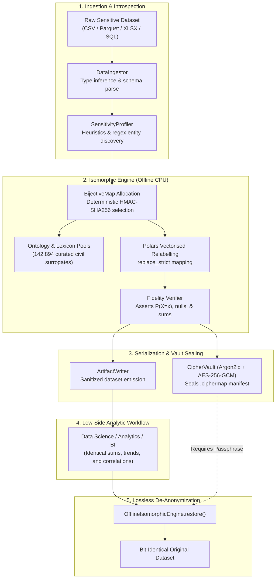

# AetherMask

[](https://github.com/aethermask/aethermask/actions/workflows/ci.yml)
[](LICENSE)
[](CHANGELOG.md)
[](pyproject.toml)
[](SECURITY.md)

**AetherMask is a 100% offline, air-gapped platform for semantic obfuscation, anonymization, and lossless de-anonymization of structured datasets.**

By projecting sensitive schemas, categorical identifiers, and free-text narrative entities into realistic civil cover domains, AetherMask produces sanitized datasets that are **mathematically and statistically isomorphic to the original for analytical workloads** — while sealing an AES-256-GCM encrypted `.ciphermap` vault that guarantees exact, bit-identical reconstruction.

---

## Key Features

- **100% Air-Gapped Execution:** Operates without remote connections, third-party CDNs, external telemetry, or model downloads. An in-process egress sentinel wraps `socket.connect` to block and log non-loopback network calls.
- **Statistical & Mathematical Isomorphism:** Preserves row counts, null topologies, distinct cardinalities, categorical distribution shapes $P(X=x)$, multi-table foreign-key relational joins, and Pearson correlation matrices.
- **Lossless Bidirectional Round-Trip:** $R \equiv \text{restore}(\text{mask}(R), \text{vault})$. Recovers column headers, original categorical labels, and verbatim free-text narratives byte-for-byte.
- **Cryptographic Vault (`.ciphermap`):** Derives AES-256-GCM encryption keys using Argon2id ($m=256\text{ MiB}, t=4, p=2$) and HKDF-SHA256, binding canonical manifest headers as Authenticated Additional Data (AAD).
- **Curated Multi-Domain Lexicon:** 142,894 unique, deterministically generated civil surrogates across 10 specialized domain profiles (defense to freight logistics, aerospace to civil aviation, cyber warfare to smart grid SCADA, and more).
- **Format Agnostic:** Ingests and re-serializes CSV, TSV, Parquet, Excel (multi-sheet XLSX with formula capture), JSON, SQL dumps (DDL + `COPY` / `INSERT`), and PostgreSQL tables.
- **Air-Gapped Data Studio GUI:** Built with React 19, Vite 8, Tailwind CSS v4, Motion 13, and TanStack Table v9. Features keyboard navigation (`Ctrl-K` command palette), dry-run diff preview, and an independent verification audit stage.

---

## Architectural Data Flow



---

## Verified Guarantees

Every security and mathematical invariant is enforced via automated test assertions:

| Invariant | Guarantee | Enforcement Mechanism | Verification Suite |
| :--- | :--- | :--- | :--- |
| **G1** | **Air-gap Enforcement** | Socket creation interception; raises on outbound egress | `test_airgap` |
| **G2** | **Statistical Isomorphism** | Identical aggregates, group-by vectors, and null topologies | `test_isomorphism`, `verify_fidelity()` |
| **G2b** | **Relational Integrity** | Preserves foreign key joins across multi-table datasets | `test_relational` |
| **G3** | **Deterministic Bijectivity** | $1 \leftrightarrow 1$ mappings; collision-free HMAC surrogate selection | `test_bijectivity` |
| **G4** | **Cryptographic Vault** | Argon2id + HKDF-SHA256 + AES-256-GCM AEAD encryption | `test_vault` |
| **G5** | **Lossless Round-Trip** | Original dataset matches restored output byte-for-byte | `test_roundtrip` |
| **G6** | **Zero Browser Egress** | Client-side `fetch`/`XHR` watchdog with CSP `'self'` enforcement | Playwright UI Suite |

---

## Quickstart

### 1. Prerequisites & Installation

```bash
# Clone the repository
git clone https://github.com/aethermask/aethermask.git
cd aethermask

# Create and activate a virtual environment
python -m venv .venv
source .venv/bin/activate  # Windows: .venv\Scripts\activate

# Install Python package with dependencies
pip install -e .

# Build the offline Data Studio frontend
cd frontend
npm install
npm run build
cd ..
```

### 2. Run the Air-Gapped Server

```bash
python -m uvicorn api.server:app --host 127.0.0.1 --port 8000
```
Open [http://127.0.0.1:8000](http://127.0.0.1:8000) in any modern browser to access the Data Studio SPA.

### 3. Headless CLI Usage

AetherMask includes a standalone CLI for headless terminal environments:

```bash
# Profile dataset sensitivity
python cli/aethermask.py profile samples/classified_missions.csv

# Obfuscate dataset and seal cryptographic vault
python cli/aethermask.py obfuscate samples/classified_missions.csv \
    --profile defense_to_logistics \
    --passphrase "Correct-Horse-Battery-2026!" \
    --outdir ./vault_out

# De-anonymize / restore back to original
python cli/aethermask.py restore vault_out/classified_missions_sanitized.csv \
    vault_out/classified_missions.ciphermap \
    --passphrase "Correct-Horse-Battery-2026!" \
    --outfile ./restored_missions.csv

# Independently verify isomorphism on a triple
python cli/aethermask.py verify samples/classified_missions.csv \
    vault_out/classified_missions_sanitized.csv \
    vault_out/classified_missions.ciphermap \
    --passphrase "Correct-Horse-Battery-2026!"
```

---

## Configuration

AetherMask is configured via environment variables. Copy `.env.example` to `.env` to customize settings.

| Variable | Type | Default | Description |
| :--- | :--- | :--- | :--- |
| `AETHERMASK_HOST` | `string` | `127.0.0.1` | Network interface for FastAPI server binding. |
| `AETHERMASK_PORT` | `int` | `8000` | Port for the API server and web interface. |
| `AETHERMASK_LOG_LEVEL` | `string` | `INFO` | Logging verbosity (`DEBUG`, `INFO`, `WARNING`, `ERROR`). |
| `AETHERMASK_BLOCK_EGRESS` | `bool` | `1` | Enforce in-process network blocking for non-loopback connections. |
| `AETHERMASK_ALLOW_LOCAL_PG`| `bool` | `1` | Allow local loopback / RFC-1918 private network PostgreSQL DSNs. |
| `AETHERMASK_MAX_UPLOAD_MB` | `int` | `2048` | Maximum file upload limit in megabytes. |
| `AETHERMASK_ARGON2_MEMORY_KIB` | `int` | `262144` | Memory cost for Argon2id key derivation (256 MiB). |
| `AETHERMASK_ARGON2_TIME` | `int` | `4` | Iteration count (time cost) for Argon2id. |
| `AETHERMASK_ARGON2_PARALLELISM`| `int` | `2` | Parallel thread lanes for Argon2id. |
| `AETHERMASK_STATIC_DIR` | `string` | `frontend/dist` | Directory containing the pre-compiled Data Studio bundle. |
| `AETHERMASK_SPACY_MODEL` | `string` | _None_ | Optional path or package name for local offline spaCy NER model. |

---

## Bundled Domain Profiles

| Profile Key | Source Domain | Target Cover Domain | Unique Tokens |
| :--- | :--- | :--- | :--- |
| `defense_to_logistics` | Kinetic Defense / Joint Operations | Commercial Freight Logistics | 83,267 |
| `aerospace_to_civil_aviation` | Combat Aviation / Air Tasking | Civil Commercial Aviation | 70,299 |
| `cyberwar_to_smartgrid` | Cyber Operations / SIGINT | Smart Grid SCADA Telemetry | 76,058 |
| `nuclear_to_civil_energy` | Fissile Materials / Weapons Program | Civil Nuclear Power Generation | 76,048 |
| `naval_to_commercial_shipping` | Naval Warfare / Maritime Patrol | Container Liner Shipping | 72,982 |
| `generic_pii_redaction` | Personnel Identifiable Information | Neutral Corporate Directory | 78,631 |
| `biodefence_to_agriculture` | Biological Defense / Chemical Threat | Commercial Agricultural Science | 71,836 |
| `finint_to_retail_analytics` | Financial Intelligence / Sanctions | Retail Customer Analytics | 70,656 |
| `space_recon_to_earth_observation`| Overhead Reconnaissance / IMINT | Earth Observation & Mapping | 70,892 |
| `cni_to_facilities_management` | Critical Infrastructure Protection | Commercial Facilities Management | 71,546 |

---

## Testing & Quality Assurance

### Run Unit & Integration Tests

```bash
# Run all tests using pytest
pytest

# Execute standalone verification suite
python tests/test_full_suite.py

# Execute API integration suite
python tests/test_api.py
```

### Run Frontend Tests & Type Checking

```bash
cd frontend
npm test
npm run build
cd ..
```

### Code Style & Linting

```bash
# Python linting and formatting checks
ruff check core api cli tests
ruff format --check core api cli tests
```

---

## Containerized Deployment (Air-Gapped Appliance)

For deployment in fully air-gapped server environments with `network_mode: "none"`:

```bash
# 1. Build and package image on connected staging machine
docker compose -f docker-compose.offline.yml build
docker save aethermask:1.0.0 | gzip > aethermask-2.1.0.tar.gz

# 2. Transfer archive to air-gapped host via secure physical media

# 3. Load and launch container on air-gapped host
docker load < aethermask-2.1.0.tar.gz
docker compose -f docker-compose.offline.yml up -d aethermask
```

---

## License

This project is licensed under the [MIT License](LICENSE).
